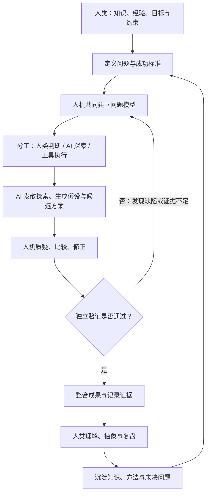

# 人机协同认知闭环

## 1. 定义

人机协同认知闭环，是指人类与 AI 围绕一个目标，经过问题定义、共同建模、探索、质疑、验证、整合和认知回流，最终既产出可信成果，也更新下一轮协作所需知识与方法的过程。

它不是简单的「提问 → 回答 → 结束」，而是一个带有验证门和学习反馈的循环。

## 2. 闭环总览

## 3. 九个阶段

| 阶段 | 主要责任 | 核心动作 | 阶段产物 |
|---|---|---|---|
| 1. 目标与边界 | 人类主导 | 明确问题、价值、风险、资源和限制 | 任务说明 |
| 2. 问题建模 | 人机共同 | 澄清概念、拆解子问题、定义成功标准 | 问题模型 |
| 3. 任务分配 | 人类负责授权，AI 提出建议 | 确定人、AI、工具各自的职责和交接条件 | 任务分工 |
| 4. 自主探索 | AI 可主导局部探索 | 生成假设、搜索资料、推演方案、尝试实现 | 候选发现 |
| 5. 批判与修正 | 人机共同 | 找反例、质疑前提、比较路径、修正假设 | 候选结论 |
| 6. 独立验证 | 按任务配置验证主体 | 测试、实验、形式化证明、来源核验或专家审查 | 验证记录 |
| 7. 结果整合 | 人类负责最终采纳 | 整理结论、适用边界、证据和未解决问题 | 可交付成果 |
| 8. 认知回流 | 人类主导，AI 辅助 | 重建推理、提炼抽象、识别知识缺口 | 个人知识更新 |
| 9. 反馈与再探索 | 人机共同 | 更新问题、方法、工具和下一轮目标 | 下一轮任务 |

## 4. 三个关键控制点

### A. 探索授权：给 AI 自主空间，但明确边界

至少需要说明：

- 目标：希望解决什么问题？
- 约束：哪些前提不能违反？
- 权限：允许读取、修改、运行或调用哪些资源？
- 预算：时间、计算、调用次数或成本限制。
- 检查点：何时汇报阶段性结果？
- 停止条件：何时结束、请求人工判断或升级处理？

自主探索不是无约束运行。任务风险越高、操作越不可逆，人工检查点应越严格。

### B. 独立验证：把「看起来合理」与「已经成立」分开

不同任务需要不同验证方法：

| 任务类型 | 可采用的验证方式 |
|---|---|
| 数学推导 | 形式化证明、独立推导、反例检查 |
| 软件工程 | 单元测试、集成测试、静态分析、代码审查 |
| 性能优化 | 可复现实验、基线对照、统计分析、回归测试 |
| 事实研究 | 原始来源、多个独立来源、时间与口径核验 |
| 决策分析 | 假设审查、敏感性分析、反方论证、专家审查 |

不能用模型自我确认代替独立验证。验证方法应与结论类型和错误成本相匹配。

### C. 认知回流：从获得答案走向获得能力

每轮协作结束时，至少回答：

1. 这次真正解决了什么问题？
2. 哪些关键思想或方法是新获得的？
3. 哪些结论已经验证，哪些仍是假设？
4. 哪些内容我现在能够独立解释和复现？
5. 下一次遇到相似问题，我能否少依赖 AI？
6. 还有哪些未知问题值得继续探索？

认知回流不要求人类复述 AI 的每一个内部推导步骤，而是要求对关键结论、适用边界、证据和可迁移方法形成足够理解。

## 5. 闭环的两种收益

| 外部增长 | 内部增长 |
|---|---|
| 扩大搜索空间 | 扩大知识体系 |
| 提高任务吞吐 | 提高独立判断能力 |
| 加快方案生成 | 提升问题抽象能力 |
| 探索更复杂的问题 | 获得可迁移的方法 |
| 形成更高质量的成果 | 降低长期认知依赖 |

只追求外部产出，容易形成「AI 替我完成任务」的单向依赖；只追求内部学习，又可能忽略 AI 能提供的规模化探索能力。两者需要同时设计。

## 6. 如何判断闭环有效

一次协作至少应记录：

- 任务目标、成功标准和风险等级；
- 人类与 AI 的实际投入和职责；
- 关键假设、重要分歧与方向变更；
- 候选结果及其证据；
- 验证方法、结果和遗留风险；
- 最终产出与实际成本；
- 人类在协作前后知识和独立能力的变化。

建议对重要任务保留 Human-only、AI-only 和 Human+AI 的可比基线。否则很难判断提升究竟来自协同机制、模型能力变化，还是额外投入。

## 7. 核心原则

**人类负责目标、价值与最终责任；AI 可以自主探索并挑战人类的既有认知；结果通过适当的独立机制验证；协作成果再回流为人类的知识与能力。**

这是一套待实践、待修正的运行框架，不是对所有任务都适用的固定流程。
